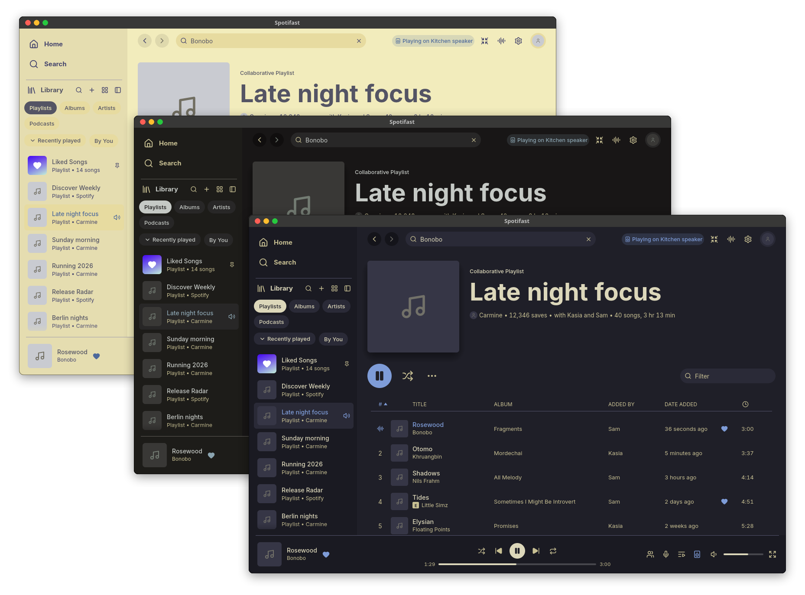
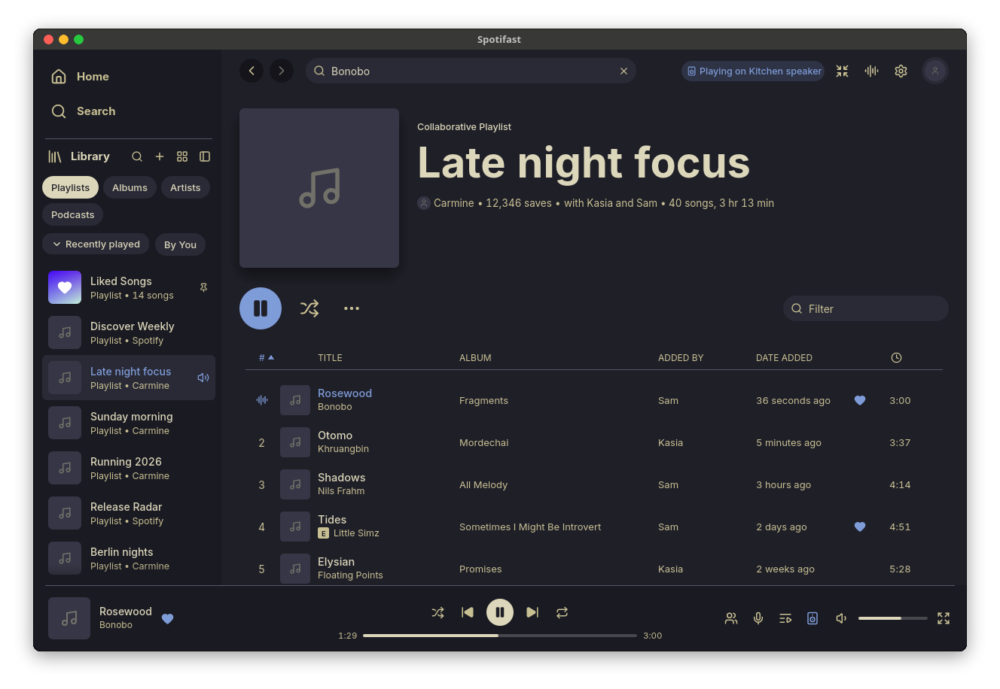
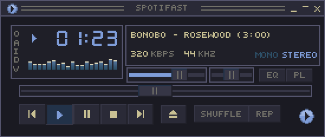
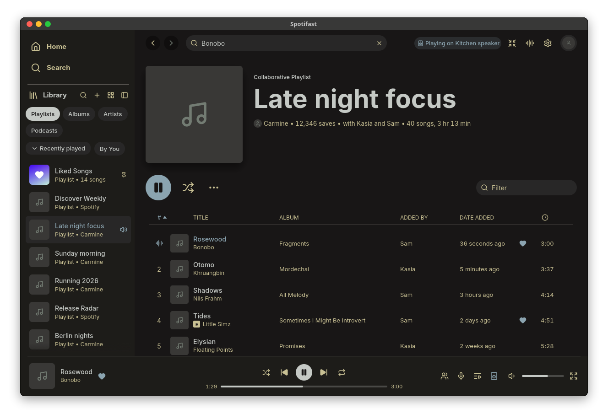
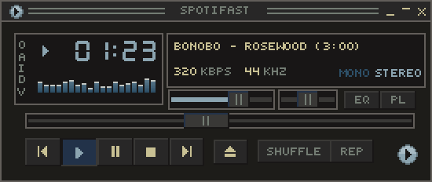
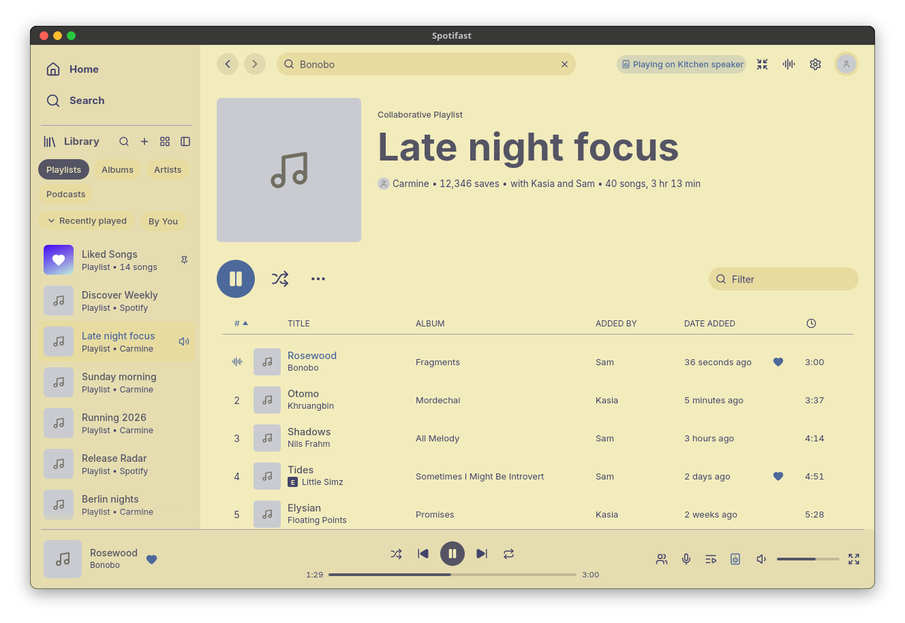
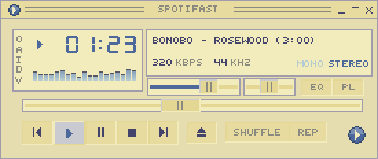

<h3>Kanagawa for <a href="https://github.com/crmne/spotifast">Spotifast</a></h3>

A community-maintained theme inspired by Hokusai's <em>The Great Wave off Kanagawa</em>.

Using the <a href="https://github.com/rebelot/kanagawa.nvim">Kanagawa palette</a> by <a href="https://github.com/rebelot">Tommaso Laurenzi (rebelot)</a>.

The skins are recolors of the <a href="https://github.com/crmne/spotifast/tree/main/assets/skins">Spotifast skins</a> by <a href="https://github.com/crmne">Carmine Paolino</a>.

 

<!-- Wave accents: carpYellow, crystalBlue, autumnRed. Lotus accents: lotusYellow, lotusBlue4, lotusRed. -->

  <a href="https://github.com/kanagawa-community/spotifast/stargazers">
    <picture>
      <source media="(prefers-color-scheme: dark)" srcset="https://img.shields.io/github/stars/kanagawa-community/spotifast?style=for-the-badge&amp;labelColor=1F1F28&amp;color=E6C384">
      <source media="(prefers-color-scheme: light)" srcset="https://img.shields.io/github/stars/kanagawa-community/spotifast?style=for-the-badge&amp;labelColor=F2ECBC&amp;color=77713F">
      
    </picture>
  </a>
  <a href="https://github.com/kanagawa-community/spotifast/releases/latest">
    <picture>
      <source media="(prefers-color-scheme: dark)" srcset="https://img.shields.io/github/v/release/kanagawa-community/spotifast?style=for-the-badge&amp;label=release&amp;labelColor=1F1F28&amp;color=7E9CD8">
      <source media="(prefers-color-scheme: light)" srcset="https://img.shields.io/github/v/release/kanagawa-community/spotifast?style=for-the-badge&amp;label=release&amp;labelColor=F2ECBC&amp;color=4D699B">
      
    </picture>
  </a>
  <a href="https://github.com/kanagawa-community/spotifast/issues">
    <picture>
      <source media="(prefers-color-scheme: dark)" srcset="https://img.shields.io/github/issues/kanagawa-community/spotifast?style=for-the-badge&amp;labelColor=1F1F28&amp;color=C34043">
      <source media="(prefers-color-scheme: light)" srcset="https://img.shields.io/github/issues/kanagawa-community/spotifast?style=for-the-badge&amp;labelColor=F2ECBC&amp;color=C84053">
      
    </picture>
  </a>

 

## Previews

🌊 Wave

🐉 Dragon

🪷 Lotus

## What it contains

Each variant has four files:

| File                                | Changes                                    |
| ----------------------------------- | ------------------------------------------ |
| `themes/Kanagawa <Variant>.json`    | The colors of the main window.             |
| `skins/Kanagawa <Variant>.wsz`      | The Winamp skin of the mini player.        |
| `skins/Kanagawa <Variant> Tall.wmz` | The Windows Media Player skin, tall shape. |
| `skins/Kanagawa <Variant> Wide.wmz` | The Windows Media Player skin, wide shape. |

The Windows Media Player skins show the crest of Hokusai's _The Great Wave off
Kanagawa_ in the glass core.

## Requirements

- Spotifast with palette files and Windows Media Player skins. Tested with
  Spotifast 0.17.1.

## Installation

Clone the repository and run `./install.sh`. It copies the palettes into the
`themes` folder and the skins into the `skins` folder of the Spotifast
configuration:

| System  | Configuration folder                                 |
| ------- | ---------------------------------------------------- |
| Linux   | `~/.config/spotifast` (`$XDG_CONFIG_HOME/spotifast`) |
| macOS   | `~/Library/Application Support/me.paolino.spotifast` |
| Windows | `%APPDATA%\paolino\spotifast\config` (Git Bash)      |

For the Flatpak, run
`XDG_CONFIG_HOME=~/.var/app/rocks.spotifast.Spotifast/config ./install.sh`.

`./install.sh` installs all three variants, or only the ones you name, for
example `./install.sh dragon lotus`. Run it again after `git pull` to update.
`./uninstall.sh` takes the same names and removes them.

Linux finds new palettes automatically. On macOS and Windows, run
`spotifast reload-themes` if Spotifast is open.

## Usage

- Main window: open **Settings → Appearance → Theme** and select
  **Kanagawa Wave**, **Kanagawa Dragon** or **Kanagawa Lotus**. With
  **Follow system**, select a dark variant as **Dark mode theme** and Lotus as
  **Light mode theme**.
- Mini player: press Ctrl+M (Cmd+Shift+M on macOS), then select a Kanagawa skin
  in **Settings → Mini player**.

Spotifast colors the top of each page from the album art. To see the Kanagawa
colors everywhere, turn off **Colour from album art**.

## Palette

Every color comes from the shared
[palette](https://github.com/kanagawa-community/.github/blob/main/docs/PALETTE.md),
picked by role, so each variant uses its own value for the same role.

| Spotifast color            | Palette role                                |
| -------------------------- | ------------------------------------------- |
| `window`, `on_accent`      | `ui.bg`                                     |
| `panel`                    | `ui.bg_m1`                                  |
| `surface`                  | `ui.bg_p1`                                  |
| `surface_hover`, `outline` | `ui.bg_p2`                                  |
| `surface_active`           | `ui.bg_visual`                              |
| `text`                     | `ui.fg`                                     |
| `secondary`                | `ui.fg_dim`                                 |
| `dim`                      | `syn.comment` (Lotus: `ui.float.fg_border`) |
| `accent`                   | `syn.fun`                                   |
| `accent_hover`             | `syn.special1` (Lotus: `ui.fg_dim`)         |
| `danger`                   | `diag.error`                                |
| `warning`                  | `diag.warning`                              |

The skins use the same roles for the same parts. The off lamps of the Winamp
skin use `ui.bg_search`. In the Windows Media Player skins, the grey shades of
the upstream pictures become a gradient through `ui.bg_m3`, `ui.bg`, `ui.bg_p1`,
`ui.bg_visual`, `ui.bg_search`, `ui.fg_dim` and `ui.fg`, and the green light
becomes `syn.fun`. Lotus runs the gradient the other way, so the glass core is
light and the ribbon is dark.

Each skin color is one role or a blend of two roles, as the upstream skins blend
their own colors. The wave keeps the colors of Hokusai's print.

## Accessibility

The ratios below are for each text color on each background color.
`text` and `secondary` are above 4.5:1 on every background in every variant.
The generator keeps the text of the Windows Media Player skins above 4.5:1 on
the glass core, so the wave is fainter in Lotus.

Some palette roles stay below 4.5:1, and the port keeps them, as the style guide
says:

- `dim` (`syn.comment`) is 2.4:1 to 4.2:1 in Wave and Dragon. In Lotus,
  `ui.float.fg_border` is 3.7:1 to 4.3:1.
- `danger` (`diag.error`) is 2.6:1 to 4.0:1.
- `warning` (`diag.warning`) in Lotus is 1.6:1 to 2.2:1.
- `accent` (`syn.fun`) is 4.3:1 on `surface_hover` in Wave, and 3.4:1 to 4.0:1
  on the raised backgrounds in Lotus.

The port does not claim WCAG conformance.

## Issues and contributions

Report bugs and request changes in this port's
[issue tracker](https://github.com/kanagawa-community/spotifast/issues).
Contributions are welcome.

See [CONTRIBUTING.md](CONTRIBUTING.md) before opening a pull request.

## License

MIT. See [LICENSE](LICENSE). The skins are recolors of the Spotifast skins,
also MIT, by Carmine Paolino.
